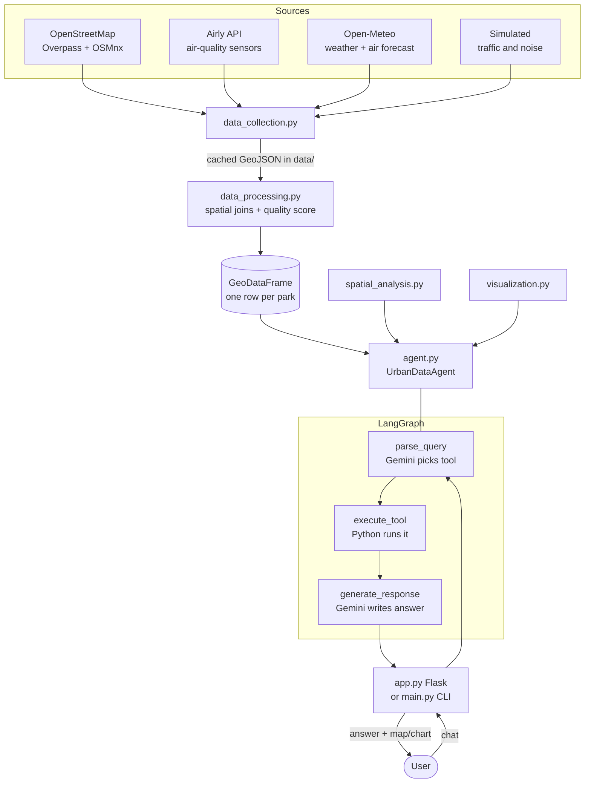

# 🌳 Bucharest Urban Data Assistant

*(Romanian name: **Asistent Date Urbane București**)*

A conversational geospatial assistant for Bucharest's parks and urban environment. You ask a question in natural language (Romanian works best). The system picks the right analysis, runs it on real geographic data, and answers in plain language. When a map or chart helps, it draws one.

> "Which sector has the most parks?" · "Where is the air cleanest?" · "Plan a walking route from Parcul Izvor to Parcul Cișmigiu." · "What's the best day to visit a park this week?" · "Where should the city build new parks?"

It is built with **Flask** (web server), **LangGraph** (agent workflow), **Google Gemini 2.5 Flash** (language understanding and answer writing), and the Python GIS stack (**GeoPandas, OSMnx, Shapely, NetworkX, Folium, Matplotlib**).

---

## Table of contents

1. [How the project behaves, in one minute](#1-how-the-project-behaves-in-one-minute)
2. [Architecture](#2-architecture)
3. [Life of a question (step by step)](#3-life-of-a-question-step-by-step)
4. [Data: sources, files and refresh rules](#4-data-sources-files-and-refresh-rules)
5. [Data processing and the quality score](#5-data-processing-and-the-quality-score)
6. [The agent and its 32 tools](#6-the-agent-and-its-32-tools)
7. [Spatial analysis algorithms](#7-spatial-analysis-algorithms)
8. [Visualizations](#8-visualizations)
9. [The web interface and HTTP API](#9-the-web-interface-and-http-api)
10. [Command-line interface](#10-command-line-interface)
11. [Project structure](#11-project-structure)
12. [Installation](#12-installation)
13. [Configuration reference](#13-configuration-reference)
14. [Running the app](#14-running-the-app)
15. [Deployment demo (GitHub Actions + ngrok)](#15-deployment-demo-github-actions--ngrok)
16. [Security](#16-security)
17. [Known limitations and quirks](#17-known-limitations-and-quirks)
18. [Troubleshooting](#18-troubleshooting)
19. [Extending the project](#19-extending-the-project)

---

## 1. How the project behaves, in one minute

1. **On startup** the app downloads or loads the cached datasets: parks, sectors, air quality, weather forecast, traffic and noise. It merges them into one table with one row per park. This runs in a **background thread**. The web page opens immediately, but the chat answers `503 Service Unavailable` until loading finishes (first run: a few minutes).
2. **When you ask a question**, Gemini reads it and chooses one of 32 built-in analysis functions (*tools*) and its arguments. The function runs in plain Python on the data. Gemini then rewrites the raw result as a friendly Romanian answer.
3. **Gemini never sees the full dataset** and does not do the math. It only chooses the tool and phrases the result. All numbers come from the code, which keeps answers grounded in the data.
4. **Charts and maps** made by a tool are saved to disk and shown in the web page next to the answer.
5. **Data refreshes** automatically every 6 hours, and on demand with the "update data" button.

## 2. Architecture



| Layer | File | Responsibility |
|---|---|---|
| Presentation | `app.py`, `templates/index.html`, `main.py` | Web server and page, or terminal chat |
| Agent | `src/agent.py` | LangGraph workflow, 32 tools, Gemini calls, conversation memory |
| Analysis | `src/spatial_analysis.py` | Accessibility, optimal park sites, sector metrics, routing |
| Output | `src/visualization.py` | Folium maps, Matplotlib charts |
| Data | `src/data_collection.py`, `src/data_processing.py` | Download, cache, clean and merge |
| Settings | `src/config.py` | Keys, paths, coordinates, refresh rules |

## 3. Life of a question (step by step)

Take the question **"Care sunt parcurile cu cea mai bună calitate a aerului?"**

1. **Browser → server.** `index.html` sends `POST /api/query` with `{"query": "..."}`.
2. **Guard checks** in `app.py`: agent not ready or data refreshing → `503`. Empty or longer than 500 characters → `400`. More than 20 questions per minute from one IP → `429`. Invalid JSON is handled as an empty query.
3. **Traffic shortcut** (`process_query`): if the text contains a traffic word (*trafic, circulație, aglomerat, drum, mașini, blocaj…*), the LLM is **skipped**. The code extracts the park name after "parcul …" and answers directly from traffic data. If no park name is found, it asks the user for one.
4. **Otherwise the LangGraph runs three nodes in a fixed line:**
   - **`parse_query`.** A prompt lists all tool names and descriptions, several Romanian and English examples, the JSON format to use, and the last 3 exchanges of history. Gemini replies with JSON such as `{"tool": "find_parks_with_best_air_quality", "args": {"top_n": 5}, "reasoning": "..."}`. The code extracts the JSON, even from a ```` ```json ```` block. If parsing fails, it falls back to the harmless `get_current_time` tool.
   - **`execute_tool`.** The chosen function is called with the arguments (`tool(**args)`). Unknown tool names and exceptions become error strings, not crashes.
   - **`generate_response`.** A second Gemini call receives the question and the tool output, and writes a Romanian answer under strict rules: no tool names, no invention, no unrelated park lists. If the tool output mentions a saved file ("saved to:", "created at:", "visualization: …"), the path is passed along so the answer can refer to it.
   - **Exception:** for weather tools (`get_weather_forecast`, `get_hourly_weather_forecast`, `get_air_quality_forecast`, `get_best_park_day`, `check_outdoor_activities`) the LLM rewrite is **skipped**. The tool's own text is returned with a short intro and a few English headings translated. This keeps the forecast tables intact.
5. **History update.** The question and answer are appended to *that browser's* conversation history (kept per visitor, see below), so follow-ups like "and in Sector 3?" work.
6. **Response.** The server returns `{response, visualization, timestamp}`. If a chart or map was produced, its URL is `/visualizations/<file>` and the page shows it in a viewer with a download button.

Each question costs **two Gemini calls** (tool choice, then answer). Traffic questions answered by the keyword shortcut cost none, and weather questions cost one.

## 4. Data: sources, files and refresh rules

| Dataset | Source | Real or simulated | Refresh | Cache file |
|---|---|---|---|---|
| Parks (named, as centre points) | OpenStreetMap via **Overpass API** (`leisure=park`, inside the Bucharest bounding box) | Real | Fetched once, then cached forever (unless `--force-update`) | `data/static/bucharest_parks_sectors.geojson` |
| Sector boundaries (`admin_level=9`) | OpenStreetMap via **OSMnx** | Real | Same as parks | (merged into the file above) |
| Air quality (AQI, PM1, PM2.5, PM10, temperature, humidity, pressure) | **Airly API** sensors within 20 km of the centre, max 100 sensors | Real, needs `AIRLY_API_KEY` | Daily (24 h file age) | `data/dynamic/air_quality.geojson` |
| Weather and air forecast, 5 days, hourly + daily | **Open-Meteo** (no key) | Real | Every run | `data/dynamic/weather_forecast_hourly.geojson`, `..._daily.geojson` |
| Road network and traffic | Road geometry from OSMnx (`drive` network); **congestion is simulated** | Geometry real, traffic **simulated** | Every run | `data/dynamic/traffic_current.geojson` (about 23 MB) |
| Noise | **Simulated** 20×20 grid over the city | **Simulated** | Every run | `data/dynamic/noise_current.geojson` |
| Final merged table | Output of `data_processing.py` | Mixed | Every load | `data/bucharest_urban_data_processed.geojson` |

### How the simulated data works

- **Traffic.** The road geometry (about 37,000 segments) is downloaded once and saved; later runs reuse the saved file and only regenerate the congestion, so startup is fast and keeps working when OpenStreetMap is slow. Use `-f` to download the roads again. Every road segment gets a congestion level from 1 (free) to 5 (blocked), drawn at random. The probabilities depend on the hour: morning rush 07–09 and evening rush 16–19 lean toward high congestion, while other hours lean toward low. Each level maps to a speed factor (1.0 down to 0.2) and an estimated travel time. **It does not reflect real traffic.**
- **Noise.** A 20×20 grid of points covers the bounding box. Base noise is 70 dB at the centre, falling 5 dB per km to a 30 dB floor. It is multiplied by a time factor (1.0 daytime, 0.8 morning and evening, 0.6 night), plus Gaussian randomness, and clamped to 30–85 dB. **It is a plausible model, not measurements.**
- **Sector population and area** (used for "parks per 100,000 residents" and "parks per km²") are **hard-coded approximations** for Sectors 1–6 in `spatial_analysis.py`.

### Failure handling

- Parks fetch fails with no cache → loading stops and the chat stays on 503. Overpass busy errors (429/502/503/504) are retried up to 3 times.
- Every download has a timeout (30–60 s), so a dead server cannot hang the app.
- Airly fails or has no key → the previously saved air-quality file is used if present, else an empty layer. The app still runs, but without air-quality answers.
- Weather fails → forecast tools report missing data.
- Traffic download fails → the saved traffic file is used.
- Overpass requires a descriptive `User-Agent`. Without one it answers `406`. The code sends one.

## 5. Data processing and the quality score

`process_and_integrate_data()` builds the single GeoDataFrame the agent works on:

1. **Clean parks.** Drop rows without a name, drop names containing "insula" (islands), and keep the first row for duplicate names.
2. **Attach air quality.** Reproject to EPSG:3857 (metres), fill missing sensor values with the mean, and join each park to its **nearest sensor** (`sjoin_nearest`). The distance is stored in `sensor_distance_meters`.
3. **Attach noise.** Nearest grid point → `noise_level_db`, `noise_distance_meters`.
4. **Attach traffic.** Nearest road segment → `congestion_level`, `speed_factor`, `travel_time_seconds`, `road_distance_meters`, and the other OSM road attributes.
5. **Compute `quality_score` (0–10, higher is better):**
   - `aqi_score = 10 − 10 × (aqi − min) / (max − min)`
   - `noise_score = 10 − 10 × (noise − min) / (max − min)`
   - `traffic_score = 10 − 2 × congestion_level`
   - The available scores are averaged, so `quality_score` is the plain mean of the air, noise and traffic scores that exist. Scores are comparable between parks, not absolute grades.
6. **Save** the result and hand it to the agent and the visualizer.

Nearest-neighbour joins can return extra rows when two candidates are equally close, so after every join duplicate park rows are removed. The result is exactly one row per park. Joins may also rename the park name column, so the final table always contains both `name` and `name_left`, because different tools look for either spelling.

## 6. The agent and its 32 tools

The agent (`UrbanDataAgent`) exposes these tools to Gemini. Each has a description and argument types used in the selection prompt.

**Park information**

| Tool | What it does |
|---|---|
| `get_total_parks` | Total park count |
| `get_parks_by_sector` | Parks per sector |
| `list_parks_in_sector(sector_id, page, page_size)` | Paged list of parks in a sector |
| `search_parks_by_name(name_pattern)` | Substring search |
| `get_park_details(park_name)` | Sector, AQI, noise, traffic, score for one park |
| `find_largest_parks(sector, top_n)` | Largest parks in a sector by area |

**Air quality**

| Tool | What it does |
|---|---|
| `find_parks_with_best_air_quality(top_n)` / `find_parks_with_worst_air_quality(top_n)` | Rank parks by AQI |
| `compare_sector_air_quality(sector1, sector2)` | Compare two sectors |
| `analyze_air_park_relationship` | Relationship between air quality and park density |
| `create_air_quality_heatmap` | Folium heatmap of AQI across parks |
| `get_air_quality_forecast(days)` | Forecast PM10, PM2.5, European AQI |

**Sectors and comparisons**

| Tool | What it does |
|---|---|
| `get_sector_statistics` | Detailed per-sector stats |
| `compare_sectors(sector1, sector2, metric)` | Metric: parks, air, noise, density |
| `find_best_sector(metric)` / `find_greenest_sector` | Best sector for a metric |
| `analyze_sectors(criteria, sort_by, reverse)` | Multi-criteria ranking |
| `create_sector_chart(metric)` / `create_sector_comparison_chart(analysis_type)` | Bar charts |
| `compare_north_south(metric)` | North vs. south of the city |

**Noise, traffic and recommendations**

| Tool | What it does |
|---|---|
| `find_parks_with_lowest_noise(top_n)` | Quietest parks |
| `get_traffic_information(park_name)` | Congestion near a park (also reachable via the keyword shortcut) |
| `recommend_best_park_today(criteria)` | Weighted ranking: air 40%, noise 30%, congestion 30% (default criteria: air and congestion). Draws a map with the winner highlighted |

**Routing and planning**

| Tool | What it does |
|---|---|
| `find_route_between_parks(origin_park, destination_park, mode)` | Shortest street route (walking, cycling, driving), with distance, time and a drawn map |
| `plan_park_tour(num_parks, start_park, metric)` | Multi-park itinerary chosen by size or quality |
| `calculate_park_accessibility(buffer_distance, region, show_poorly_served)` | Share of the city within walking distance of a park |
| `find_optimal_park_locations(num_locations)` | Best places for new parks |

**Weather and time**

| Tool | What it does |
|---|---|
| `get_weather_forecast(days)` | Daily forecast |
| `get_hourly_weather_forecast(day, time_period, hours)` | Hourly detail for a day or time-of-day |
| `get_best_park_day(park_name)` | Best day to visit, from weather and air forecast |
| `check_outdoor_activities(day, activity_type)` | Suitability for picnic, running, cycling, etc. Uses a comfort score (below) |
| `get_current_time` | Current date and time |

**Comfort score** (outdoor activities): per time period (morning, noon, afternoon, evening, night) it adds points for temperature (20–25 °C best), light wind (2–10 km/h), no rain, and clear sky, and subtracts for extremes. Sport activities adjust for heat.

**Conversation memory.** Each browser gets its own conversation, tracked with a random `sid` cookie (up to 500 conversations are kept in memory, oldest dropped first). Each conversation keeps the last `MAX_HISTORY_LENGTH` exchanges (10), and the tool-selection prompt sees the last 3. The terminal chat has one shared conversation. History is lost when the server restarts. Questions are processed one at a time because the tools share plotting state.

**Matching names.** Park-name searches ignore accents and case, so "Cismigiu" finds "Cișmigiu".

**Errors.** If Gemini is unreachable the user sees a clear Romanian message instead of a wrong answer. A rate-limit reply (HTTP 429) is retried after a pause, and if it persists the user is told to wait a minute.

## 7. Spatial analysis algorithms

- **Park accessibility.** Parks are projected to metres and buffered by the walking distance (default 500 m). The buffers are merged with a union (no double counting), clipped to the city boundary, and the area is compared to the city's area. Output: percent accessible, accessible km², and city km².
- **Optimal new park locations.**
  1. Compute underserved land = city boundary minus the 500 m coverage.
  2. Lay a 50×50 candidate grid and keep points inside the underserved zone.
  3. Score each: `0.3 × distance to nearest park + 0.7 × underserved area within a 500 m circle`.
  4. Pick the best, enforcing a minimum spacing between picks (default 1 km) so suggestions spread out.
- **Routing.** The drivable OSM graph is loaded once (lazily, then cached in memory). Park centres snap to the nearest graph nodes, and Dijkstra (`networkx.shortest_path`, weighted by length) finds the path. Parks are matched by case-insensitive partial name. Walking time is derived from distance.
- **Sector green metrics.** Parks per sector, parks per km², parks per 100,000 residents, plus mean/min/max AQI per sector. Population and area are the built-in approximations noted above.
- **Boundary.** The city polygon is fetched with `ox.geocode_to_gdf`. If that fails, the bounding box from `config.py` is used.

## 8. Visualizations

- **Interactive map** (Folium). The home page map shows every park as a marker, coloured by air quality or noise when available, with popups of the park's data. Other maps: heatmap, route map, optimal-locations map, accessibility map. Saved as HTML in `data/` and served under `/maps/<file>`.
- **Charts** (Matplotlib, headless `Agg` backend). Sector comparison bar charts, route images, tour maps, and recommendation maps are saved as PNG in `visualizations/` (created automatically). Some use a **contextily** basemap for street context. They are served under `/visualizations/<file>`.
- **Showing them.** When a tool reports a file it saved, the agent finds it automatically. Images appear in the viewer under the chat, and interactive maps (`.html`) appear in an embedded frame. Only files produced by the *current* question are shown, so an old chart never reappears on an unrelated answer. Answers never print server file paths.

## 9. The web interface and HTTP API

The page (`templates/index.html`, Bootstrap, Romanian UI) has:

- a header with park count, last update time and an **update data** button,
- the interactive **map**,
- a **chat** panel with a loading indicator and a **help** dialog of example questions that you can click to send,
- a **visualization viewer** with download and close buttons.

| Route | Method | Purpose |
|---|---|---|
| `/` | GET | Main page. Renders the park map and sector counts |
| `/api/query` | POST | Body `{"query": "..."}` → `{response, visualization, timestamp}`. `400` empty/too long, `429` too many questions, `503` agent not ready or data refreshing |
| `/api/map?type=heatmap&column=aqi` | GET | Generate a map on demand; returns `{map_url}` |
| `/update-data` | POST | Start a forced refresh in a background thread (`409` if one is running, `429` if used within the last 5 minutes) |
| `/maps/<file>` | GET | Serve generated map HTML |
| `/visualizations/<file>` | GET | Serve generated charts/images |
| `/debug-data` | GET | Loading status and row count (handy to check whether loading has finished). With `DEBUG_MODE=true` it also shows columns and a sample row |

Two background mechanisms keep it running: the **startup loader thread**, and a **daemon thread** that sleeps 6 hours, then reloads everything. A lock guarantees only one load runs at a time. While a load is running, `/api/query` returns `503`. Responses carry basic security headers (`nosniff`, `X-Frame-Options`), and chat text is shown as escaped text, so it cannot inject HTML into the page.

## 10. Command-line interface

`python main.py` loads the same data, prints a Romanian banner and example questions, then loops reading questions with the same agent as the web app. Commands: `ajutor`/`help`, `ieșire`/`exit`/`quit`/`bye`, Ctrl+C. It prints the response time per question and, when a chart or map was made, its file name. Flags: `-f/--force-update`, `-v/--verbose`. It suppresses stderr noise (GDAL warnings) during imports.

`list.txt` holds about 50 example questions grouped by topic: general info, air quality, sector comparison, routes, accessibility, weather, recommendations, environment, traffic, technical. Use it as a test script.

## 11. Project structure

```
.
├── app.py                  Flask web server, background loaders, HTTP API
├── main.py                 Terminal chat interface
├── requirements.txt        Python dependencies
├── list.txt                Example questions by topic
├── README.md               This file
├── .env.example            Template for API keys (copy to .env)
├── .gitignore              Keeps .env, caches and generated data out of git
├── src/
│   ├── config.py           Keys (from .env), URLs, bounding box, file paths, refresh helper
│   ├── data_collection.py  Overpass/OSMnx, Airly, Open-Meteo, simulated traffic/noise
│   ├── data_processing.py  Cleaning, spatial joins, quality score
│   ├── agent.py            LangGraph workflow, 32 tools, Gemini client
│   ├── spatial_analysis.py Accessibility, optimal sites, sector metrics, routing
│   └── visualization.py    Folium maps and Matplotlib charts
├── templates/
│   └── index.html          Web UI (Bootstrap, chat, map, viewer)
├── data/                   (generated) cached datasets and map HTML
│   ├── static/             parks + sectors
│   └── dynamic/            air quality, weather, traffic, noise
├── visualizations/         (generated) chart and route images
└── .github/workflows/
    └── run-and-expose.yml  Demo: run app on GitHub Actions + ngrok tunnel
```

## 12. Installation

**Requirements:** Python 3.10+ (developed on 3.12), internet access, a Gemini key, and an Airly key for air-quality data. The geospatial packages (geopandas, rasterio, pyproj, shapely) can be hard to build with pip on Windows. If installation fails, use conda or prebuilt wheels.

```bash
# 1. Virtual environment
python -m venv env
#   Windows PowerShell:  env\Scripts\Activate.ps1
#   Linux / macOS:       source env/bin/activate

# 2. Dependencies
python -m pip install --upgrade pip
pip install -r requirements.txt

# 3. API keys
cp .env.example .env        # Windows: copy .env.example .env
#    then edit .env
```

`.env`:

```
GEMINI_API_KEY=your_gemini_key_here
AIRLY_API_KEY=your_airly_key_here
```

- **Gemini key:** https://aistudio.google.com/apikey
- **Airly key:** register at https://developer.airly.org

## 13. Configuration reference

Environment variables (from `.env` or the shell):

| Variable | Default | Effect |
|---|---|---|
| `GEMINI_API_KEY` | *(empty)* | Required for answers. Without it every reply is an error message |
| `AIRLY_API_KEY` | *(empty)* | Required to download air-quality data |
| `PORT` | `5000` | Web port (also `-p`) |
| `HOST` | `127.0.0.1` | Bind address (also `--host`). The default is local-only. Use `0.0.0.0` to share on your network |
| `DEBUG_MODE` | `False` | `true` makes `/debug-data` show columns and a sample row |
| `LANGUAGE` | `ro` | Language of AI-written answers: `ro` (Romanian) or `en` (English). Fixed text such as weather tables, traffic sentences and error messages stays Romanian |

Constants in `src/config.py`:

| Constant | Value | Meaning |
|---|---|---|
| `GEMINI_MODEL` | `gemini-2.5-flash` | Model used for both Gemini calls |
| `GEMINI_API_URL` | `https://generativelanguage.googleapis.com/v1beta/models` | REST endpoint |
| `GEMINI_TIMEOUT` | `120` s | Per-request timeout |
| `BUCHAREST_BBOX` | S 44.38, W 25.96, N 44.52, E 26.26 | Area for parks and the noise grid |
| `BUCHAREST_LAT/LON` | 44.4268, 26.1025 | Centre for sensors, weather and map |
| `SEARCH_RADIUS_KM` / `MAX_SENSORS` | 20 / 100 | Airly sensor search |
| `MAX_HISTORY_LENGTH` | 10 | Question/answer exchanges remembered per conversation |

Command-line flags (`app.py`): `-p/--port`, `--host`, `-d/--debug` (only allowed on `127.0.0.1`), `-f/--force-update`. Limits at the top of `app.py`: question length 500, 20 questions per minute per IP, 500 stored conversations, 5 minutes between manual updates.

## 14. Running the app

```bash
python app.py            # web app → http://localhost:5000 (this computer only)
python app.py --host 0.0.0.0   # reachable from other devices on your network
python app.py -f         # re-download every dataset first
python main.py           # terminal chat
```

**First start:** parks and the road network are downloaded, which takes a few minutes. Later starts reuse the saved files and take about half a minute. Watch the terminal for *"Încărcare date finalizată cu succes"*, or open `/debug-data` and wait for `"is_updating": false`. Until then the chat shows *"Eroare HTTP 503"*. This is expected. Later starts reuse the caches and are much faster. Traffic, noise and weather are regenerated every time.

## 15. Deployment demo (GitHub Actions + ngrok)

`.github/workflows/run-and-expose.yml` runs on every push to `main` (or manually). It installs Python 3.10 and the dependencies, starts the app on port 5000, installs ngrok, opens a tunnel, and prints a public URL in the log. It then keeps the job alive for 2 hours. Set these **repository secrets**:

| Secret | Purpose |
|---|---|
| `NGROK_AUTH_TOKEN` | Required. The workflow aborts without it |
| `GEMINI_API_KEY` | Passed to the app as an environment variable |
| `AIRLY_API_KEY` | Passed to the app as an environment variable |

This is a demo setup, not production hosting. Anyone with the URL can use your Gemini quota while it runs.

## 16. Security

- Secrets are read only from environment variables / `.env`. No keys are hard-coded.
- `.env` is git-ignored. Commit only `.env.example`.
- **If a key was ever committed, revoke it and issue a new one.** Deleting it in a later commit does not remove it from git history.
- The Gemini key is sent in the `x-goog-api-key` header, not in the URL, so it doesn't end up in logs.
- The server listens on `127.0.0.1` by default, and `--debug` is refused on any other address (the Flask debugger would allow remote code execution).
- Chat output is HTML-escaped in the browser, internal errors are logged but not sent to users, and file paths never appear in answers.
- Built-in protection: per-IP rate limit on questions, a question length cap, a cooldown on manual data updates, and security headers.
- There is **no login**. Anyone who can reach the server can chat and trigger a data update (at most every 5 minutes). If you expose the app beyond a short demo, put it behind a reverse proxy or tunnel with authentication. The rate limit is in memory and tied to the IP address the server sees, which behind a tunnel such as ngrok may be the tunnel's address.

## 17. Known limitations and quirks

- **Traffic and noise are simulated**, and sector population and area are fixed approximations. Treat those answers as demonstrations.
- **Fixed text is Romanian.** `LANGUAGE=en` changes the AI-written answers, but weather tables, traffic sentences and error messages remain in Romanian.
- **Tool choice depends on Gemini.** An odd question may map to the wrong tool. Rephrase, or mention the topic explicitly (air, noise, sector, route…). An unparseable reply falls back to *get_current_time*.
- **Gemini free-tier limits.** The free tier allows only a few requests per minute, and each question uses two. Fast typing can hit the limit; the app then asks the user to wait a minute. A key with a higher quota removes this.
- **One question at a time.** Concurrent users are queued, because the plotting tools share state.
- **Routing uses the drivable network** for all modes, so walking and cycling routes follow roads, not park paths.
- **Air quality depends on sensors**: each park gets its nearest sensor's reading, which can be several km away (`sensor_distance_meters` shows how far).
- **Traffic keyword shortcut.** Questions containing *trafic, circulație, aglomerat, aglomerație, mașini, masini, blocaj* are answered without the AI and need the park name written as "parcul …".
- `agent.py` is about 6,300 lines in one file.
- No automated tests are included. `list.txt` is the manual test list.

## 18. Troubleshooting

| Symptom | Cause / fix |
|---|---|
| Chat says **"Eroare HTTP 503: SERVICE UNAVAILABLE"** | Data is still loading or a refresh is running. Wait. Check `/debug-data`. If it never finishes, read the terminal for the failing step |
| Map shows **"Nu există date disponibile"** | Same as above: data hasn't loaded |
| `Could not connect to Overpass API … 406` | Overpass blocked the request. The code sends a `User-Agent`. Make sure you have the latest `data_collection.py` |
| Overpass `429`/`504` or timeouts | The public Overpass server is busy. Retry in a few minutes |
| "Nu mă pot conecta la modelul AI" | Missing or wrong `GEMINI_API_KEY` (`.env` in the project root) or no internet |
| "Am atins limita de cereri a modelului AI" | Gemini quota reached (HTTP 429). Wait a minute, or use a key with a higher quota |
| "Prea multe întrebări într-un timp scurt" | The app's own limit of 20 questions per minute per IP |
| `Airly API key not found` | Set `AIRLY_API_KEY` in `.env`. The app runs without it but has no air-quality answers |
| Air-quality answers are empty | No key, or the sensors returned nothing. Delete `data/dynamic/air_quality.geojson` and restart with `-f` |
| `pip install` fails on geopandas/rasterio | Use conda (`conda install geopandas osmnx rasterio`) or install prebuilt wheels |
| Stale or wrong data | Click **update data**, or run `python app.py -f`, or delete the `data/` folder |
| Port already in use | `python app.py -p 5001` |
| Page not reachable from another device | The server is local-only by default. Start with `--host 0.0.0.0` |

## 19. Extending the project

**Add a new tool** (about 10 minutes):

1. Write a method in `UrbanDataAgent` that returns a **string** (a description of the result). If it makes an image, save it under `visualizations/` and include the text `saved to: <path>` in the string.
2. Register it in `_setup_tools()` with a clear `description`, the `function`, and its `args` types.
3. Optionally add a routing hint or example in the `_parse_query_node` prompt for tricky phrasings.

**Replace simulated data with real data.** Swap `fetch_traffic_data()` for a traffic API and `fetch_noise_data()` for real noise-map data. Keep the same output columns (`congestion_level`, `speed_factor`, `travel_time_seconds`, `noise_level_db`). Nothing else needs to change.

**Switch the model.** Change `GEMINI_MODEL` in `config.py`. To use another provider, replace `call_gemini()` in `agent.py`. It takes a prompt and returns text, and the rest of the agent only depends on that.

**Other ideas.** Real census data for sectors, a login, shared rate limiting for several server processes, automated tests that run `list.txt` against the tools, and splitting `agent.py` into one module per tool group.

---

*Data © OpenStreetMap contributors · Air quality by Airly · Forecasts by Open-Meteo · Language model by Google Gemini.*
